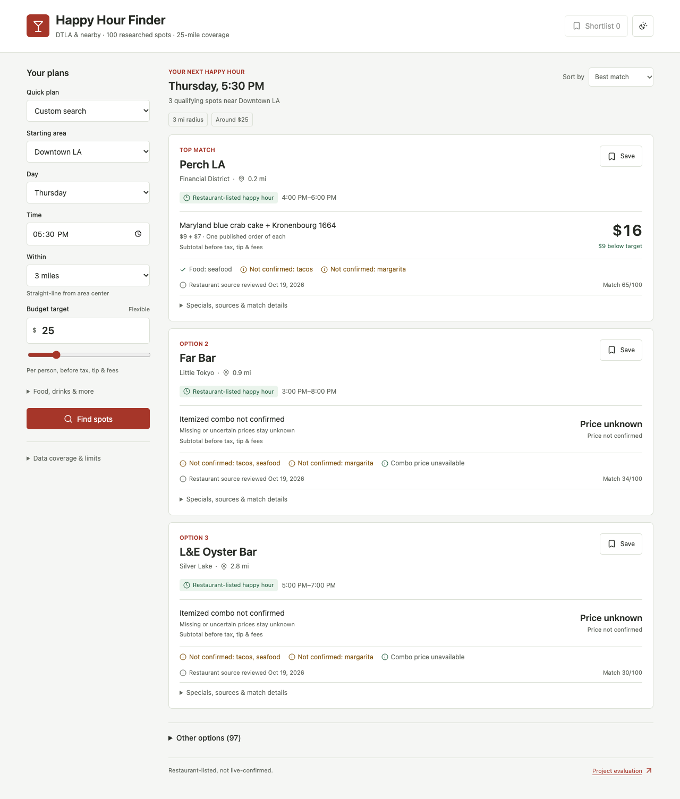

# Evaluate and Improve My AI-Assisted Happy Hour Finder

## Solution And Screenshots

[App URL](https://knmarquez25.github.io/happy-hour-finder-v1/). The improved version is committed locally; publishing is pending GitHub write authorization. The screenshot below shows the improved version.

The AI contribution is source research and structured data curation, development, and evaluation assistance. The website's runtime recommendation engine is deterministic; it is not an LLM chatbot or live web search.

## 1. Updated Answers To The Five Questions

**What am I trying to improve?** Make choosing a happy-hour spot easier without opening many websites or social platforms, comparing hours manually, or guessing whether a deal fits my plans.

**What does the system need to know?** Starting area, day/time, approximate budget, food/drink preferences, atmosphere, and travel distance. It also needs restaurant-specific schedules, menu prices, offer restrictions, source links, and review dates. Missing information must stay unknown.

**What should it produce?** A ranked list with happy-hour windows, approximate straight-line distances, real itemized food-and-drink subtotals where supported, budget differences, and source details. Budgets are flexible; slightly higher or lower options are useful. Subtotals exclude tax, tip, and fees.

**How would I know it was good?** A user can find an option that meets required timing/location/preferences and has a supported cost near their budget. Over-budget or uncertain details should be explicit. A match score is not a confidence percentage.

**What feedback would improve it?** Reports of outdated hours/prices, missing places, incorrect restrictions, and poor preference matches, plus whether people would actually choose a recommendation. Human usefulness feedback is a next step, not something this benchmark already measured.

## 2. Ways To Evaluate And Data Needed

- Search success: fixed search inputs and independently reviewed acceptable results.
- Schedule/price evidence: restaurant-owned pages or menus, review dates, and item quantities.
- Required-filter validity: real location coordinates, schedules, and explicit must-haves.
- Usability: task-completion observations and user feedback, still to collect.

## 3. Outcome, Criteria, And Gold Data

My outcome is that more searches produce a suitable, source-supported option in the top three. I defined 15 benchmark searches before collecting the expanded data, including surrounding-area searches and no-match cases, plus five held-out searches.

For positive cases, at least one top-three result must have independently supported timing/location and a food-and-drink subtotal at or below the target plus $5. There is no lower-spend limit. The $5 evaluation band represents a modest overage; it does not remove higher-priced results from the app. Required food/drink preferences apply only when explicitly selected. Negative cases require an honest empty primary result.

Gold labels were reviewed separately from ranking code and outputs, with source links and known uncertainties. This was AI-assisted source review rather than a human user study. Empty positive cases remain failures.

## 4. Baseline

I preserved the original 28-venue version and ran the fixed benchmark. **Baseline: 1/15 (6.7%).** On the positive searches it succeeded 0/11; on negative controls 1/4. The benchmark deliberately includes surrounding areas and validation cases that V1 did not support well; this is not an overall accuracy estimate.

## 5. Improvements

I expanded to **100 researched locations** around DTLA; 100 currently have checked coordinates within the 25-mile scope. 73 have restaurant-supported schedule evidence, and 38 contain exact published food/drink price records. Not all have complete or unrestricted offers.

I replaced unsupported combo totals with itemized arithmetic or an explicit unknown, made budget a flexible preference, recalculated distance from the selected area, separated qualifying results from uncertain alternatives, and respected timing boundaries and must-haves. The Focused list UI adds sorting, expandable source details, mobile layout, and a three-spot shortlist. Public-guide collection checks access policy and caches source material; operator facts are reviewed before acceptance. It is an offline researched dataset, not continuously live scraping.

## 6. Comparison, Limitations, And Next Steps

| Measure | Original version | Improved version |
| --- | --- | --- |
| Fixed 15-case benchmark | 1/15 (6.7%) | 12/15 (80.0%) |
| Positive search success | 0/11 | 8/11 |
| Correct negative controls | 1/4 | 4/4 |
| Held-out 5-case benchmark | 0/5 (0.0%) | 4/5 (80.0%) |

**Improved benchmark: 12/15 (80.0%)**, compared with 1/15 (6.7%). Held-out performance was 4/5 (80.0%), versus 0/5 (0.0%).

The remaining benchmark failures are DTLA weekend, Glendale, and Burbank searches without sufficiently evidenced unrestricted priced combinations. The held-out failure is DTLA at 6 PM. Unknown details were not filled in just to increase the score.

Limitations include the small test set, older PDFs, source conflicts, approximate geocodes, and no live restaurant confirmation. The fixed ten-venue source audit has primary evidence for only two venues and unknowns for eight, so I cannot claim a source-accuracy percentage. Because several improvements shipped together, these scores do not isolate the effect of each change.

Next I would verify menus in the failing areas/time windows, collect real user choices and usefulness feedback, and add new versioned evaluation cases while keeping this benchmark unchanged for comparison.

[Detailed evaluation and reproducibility notes](evaluation-report.md)
