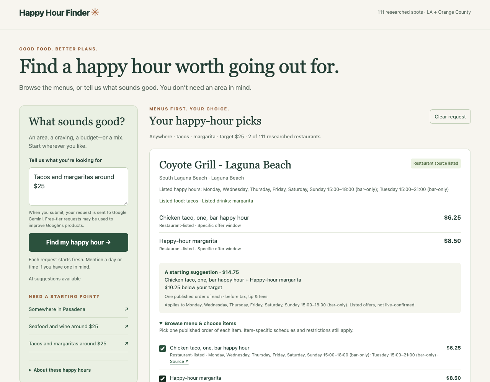
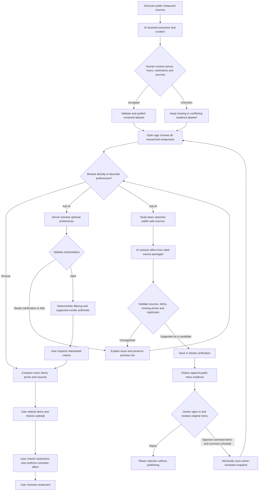

# Happy Hour Finder: browse first, ask AI when you want help

**Public build:** [Happy Hour Finder](https://knmarquez25.github.io/happy-hour-finder-v1/). Tested in a fresh unauthenticated Chrome session on October 25, 2026. No account or API key is needed by visitors.

**Final submission destination:** [Bruin Learn — Final Build](https://bruinlearn.ucla.edu/courses/237790/discussion_topics/1491803). This discussion requires a link to the build in the class gallery and answers to steps 1–6. No separate gallery link appears in the discussion instructions; its destination still needs to be established. Nothing has been posted. Replace this note with the actual gallery-post link once the public build is ready and posted.

## 1. Updated answers to the five questions

**What am I trying to improve?** Discovering a happy-hour place without hunting through websites, menus, TikTok, and other posts just to find what I can order and what it costs. I often do not know which area I want, so the app should let me explore first.

**What does the system need to know?** Whatever I choose to share: an area, food or drinks I want, an approximate budget, and optionally a day/time or atmosphere. It also needs restaurant-specific menu items, prices, schedules, restrictions, source links, and review dates. Missing details must stay unknown.

**What should it produce?** One browsable restaurant list, with menu items and prices up front. AI interprets my request and narrows that same list. The new discovery workflow searches beyond it and places cited candidates into Needs verification; only I can approve publication. Each restaurant can offer an initial food-and-drink suggestion, but I can browse the menu, select my own items, and see the subtotal before tax, tip, and fees.

**How would I know it was good?** I can find a place I would actually choose, understand what I could order and spend, and see which details still need confirmation. The AI should preserve my request accurately rather than return attractive but unsupported deals.

**What feedback would improve it?** Incorrect prices/hours, missing restaurants or menu items, misunderstood requests, confusing restrictions, and whether people chose a suggested restaurant or kept searching. I would also ask whether browsing without a chosen area helped.

## 2. Working build, instructions, and example

Open the public build and browse all **111 researched restaurants** immediately. Type an area, food/drink preference, or budget in the helper and submit. Every recorded menu item is visible on its restaurant card. Choose your own items, and Clear request to restore the full list. The backend holds a private Gemini key; visitors do not supply one. Local developer instructions (`npm ci`, `npm start`, Node 22+) and the GitHub Pages + Render Free setup are in [deployment.md](deployment.md).

Example request: **“Tacos and margaritas around $25.”** With AI configured, inspect its interpreted criteria and browse matching menus. The reviewed dataset includes Coyote Grill in Laguna Beach: a bar happy-hour chicken taco ($6.25) and margarita ($8.50) make a **$14.75 subtotal** before tax, tip, and fees, under a documented shared bar-only offer window. This is published-source evidence from the stored snapshot, not a current restaurant guarantee. Users may choose different menu items instead. Clear request restores the full list.

## 3. Workflow, decision space, and human approval points

The user decides whether to supply an area, which preferences matter, whether to revise the interpretation, what to order, and where to go. Budget remains flexible; overages are labeled. Human source review controls what enters the dataset. Publishing and API-account setup stay with the project owner. The app does not order, book, or message anyone.

## 4. Evaluation results, improvements, and a challenge case

Improvements: no required dropdowns or area on entry; one reviewed browsing list plus a separate Needs verification queue; server-side AI interpretation and source-based discovery; menu-first cards; custom item selection; source and restriction visibility; graceful AI failure and Clear behavior.

**107/107 unit and HTTP tests passed**, including the new discovery and review workflow checks. The new browser regression passed at four viewport widths; the preserved previous interface passed its existing browser checks at six widths. Checks verify browsing all 111 records, deterministic filtering and arithmetic, optional/overnight timing, unknown prices, conditional offers, malformed AI responses, HTTP protections, and desktop/mobile flows. External AI responses are fixtures in these checks. Three additional **live smoke cases passed (3/3)** from the public GitHub Pages app in a fresh unauthenticated Chrome session: tacos/margaritas/$25, area-only Pasadena, and a clarification for “near me.” The first two matched every expected preference field; the third asked for an area and preserved browsing. Warm response times were about 0.81–1.24 seconds. This is a small integration check, not general model accuracy or a user study. Full scope and reproducibility are in [ai-discovery-evaluation.md](ai-discovery-evaluation.md).

New-place live check (October 26): “martinis” searched eight source pages and saved one unverified candidate. A second Los Angeles martini request produced four accepted candidates in total: Fiesta Cantina, Birds Hollywood, Queen’s Raw Bar, and Esters Wine Shop and Bar. All four are outside the original researched list, and their missing supported prices are labeled “Price needs confirmation.” The shared queue survived a new page load and loaded in the signed-in owner view. Owner sign-in, unsigned owner denial, and direct public database denial were checked live. Actual results are recorded in [live-discovery.json](../evaluation/live-discovery.json). The restaurant-owned source preference in the second request was not fully met: returned sources were guides, so this is a partial source-quality result, not four verified recommendations. Live publication still requires the owner's review; automated fixtures test the approval snapshot and reload path.

The unchanged historical engine benchmark still measures **1/15 → 12/15** on development cases and **0/5 → 4/5** on held-out cases. These are prior engine results, not scores for the new AI feature.

Challenge: an older guide suggested a martini happy hour at Esters, while its current domain redirected to a landing page and indexed official pages indicated closure. It remains unapproved. This illustrates why a cited search result cannot automatically become a recommendation. A second challenge is a Friday oyster price that requires the documented sparkling-wine glass can look cheaper than it really is if the user selects the oyster alone. Pairing and shared-window checks prevent presenting that selection as a confirmed valid offer. Unknown prices remain unknown.

## 5. Remaining risks, safeguards, and next steps

Menus become outdated, restaurant coverage and item transcription are incomplete, and the model may misunderstand a request even when its response has a valid shape. Reviewed sources, visible interpreted criteria, evidence labels, explicit restrictions, server-side validation, and deterministic calculations reduce these risks without guaranteeing correctness. Source-review dates are not live confirmation. No allergy-safety or current-availability guarantee is made.

API keys stay server-side. Requests have length limits, timeouts, and request quotas; users see that their submitted text goes to Google Gemini and Tavily. The app is publicly deployed on GitHub Pages with a Render Free backend and has passed a small live AI check. Free quotas may make AI temporarily unavailable, and Render may take 50 seconds or more to wake after inactivity. Broader live-model evaluation, account usage monitoring, closure checks, and user testing remain necessary. Live search sometimes timed out, and broad searches missed valid offers; source coverage and completeness are not guaranteed.

## 6. What I want to build next

My next direction would expand this **menu-evidence assistant** with change detection, stronger conflicting-price checks, owner editing of published offers, and more complete menu/PDF coverage. That addresses the original research burden while keeping the discovery experience simple. I would start with official menu pages before expanding to social-platform content, where access and interpretation are harder.

Menu display update (October 26): Unverified cards show their available extracted happy-hour items, including food and drinks beyond the search craving. New extraction asks for all supported items (maximum 20 per venue), and “Find more menu items” runs a targeted lookup for an existing pending place. It uses one basic Tavily search plus Gemini extraction, keeps exact venue matching, and never auto-approves. The menu preview is cached on the server for up to one hour; it does not replace the durable original submission. Only an explicit owner approval saves the reviewed menu into the published list. Sources can be incomplete, so the UI labels the menu as potentially partial and keeps a direct source link. Public source details are limited to 240 characters; original evidence stays in the saved record.
